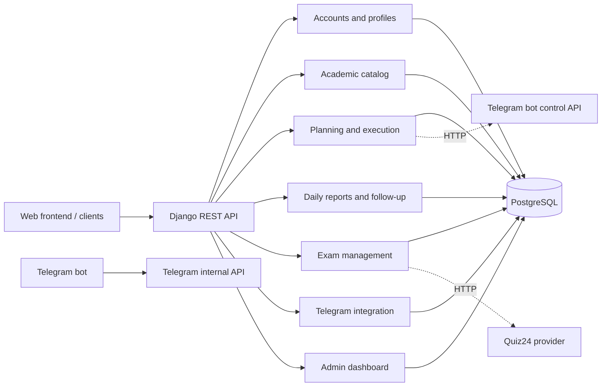

# Amootech Backend

Amootech Backend is the Django REST API for an educational management and student planning platform. It supports student and counselor workflows for academic planning, study reporting, exam management, and Telegram-linked services. The web frontend is maintained separately in [amootech-platform-frontend](https://github.com/heldajafari904-lgtm/amootech-platform-frontend).

Amootech brings student records, counselor-led academic plans, daily study reports, progress review, and assessment workflows into one system. The backend implements core student, counselor, administrator, and integration APIs; it is an active development codebase rather than a documented production distribution. Broader educational support goals should not be read as a claim that every related service is implemented.

## Contents

- [Features](#features)
- [Users and workflows](#users-and-workflows)
- [Why Amootech](#why-amootech)
- [Technology stack](#technology-stack)
- [Architecture](#architecture)
- [Project structure](#project-structure)
- [Detailed guides](#detailed-guides)
- [Local development](#local-development)
- [Configuration](#configuration)
- [API](#api)
- [Data model and migrations](#data-model-and-migrations)
- [Testing](#testing)
- [Deployment](#deployment)
- [Security notes](#security-notes)
- [Contributing](#contributing)
- [Roadmap and known gaps](#roadmap-and-known-gaps)
- [License and contact](#license-and-contact)

## Features

The codebase currently implements the following areas:

- **Accounts and profiles:** custom users with `ADMIN`, `COUNSELOR`, and `STUDENT` roles; student and counselor profiles; student registration and self-service profile endpoints; JWT access and refresh tokens; mobile verification flow with a configurable SMS adapter and a development outbox option.
- **Academic catalog:** grades, fields, subjects, chapters, and topics; provider catalog synchronization and a local catalog seed command.
- **Planning:** counselor-authored draft and published plans, plan days and activities, fixed commitments, school slots and events, execution timers, and PDF/Excel exports.
- **Daily reports and follow-up:** student reports and progress, activity-level measurements and test counts, counselor views and review actions, dashboard and follow-up endpoints.
- **Exams:** exam creation and management, student assignments and attempts, participation tracking, result and analytics workflows, study-source catalog endpoints, and Quiz24 provider integration.
- **Telegram integration:** linked student/group connections, plan and report operations, execution updates, progress queries, counselor broadcast, and admin controls and audit records.
- **Admin dashboard:** summary, counselor and Telegram summaries, recent activity, and bulk student assignment endpoints.

## Users and workflows

The backend defines three application roles. Object ownership and view-level permissions restrict access to records; the summaries below describe the workflows represented in the current APIs.

| Role | Supported workflows |
| --- | --- |
| `ADMIN` | Manage student and counselor records, assign students to counselors, access administrative summaries and activity, manage academic catalog data, and administer Telegram connections. |
| `COUNSELOR` | Work with assigned students, create and publish plans, review progress and daily reports, manage exam workflows, and act on counselor follow-up and review records. |
| `STUDENT` | Register and maintain the student's own profile, use assigned plans and execution/report flows, view progress, and use available exam and practice workflows. |

The application therefore connects plan creation with recorded execution and review. Telegram provides a service integration for selected student-facing plan, report, progress, and automation operations; it does not replace the backend as the source of business data.

## Why Amootech

Amootech connects academic planning, daily activity reporting, and counselor review in a shared workflow. Students can record progress against plans, while counselors and administrators have APIs for supervision and operational management. This provides a concrete base for coordinated educational workflows and future automation without implying that unimplemented services are already available.

## Technology stack

| Area | Technology |
| --- | --- |
| Language | Python 3.12 (Docker image); type syntax in source requires Python 3.10 or newer |
| Web framework | Django 5.2.17 |
| API | Django REST Framework 3.18.1, REST/JSON, versioned primarily under `/api/v1/` |
| Database | PostgreSQL; Compose uses PostgreSQL 17 |
| Authentication | `djangorestframework-simplejwt` JWT bearer authentication |
| API schema | `drf-spectacular` with OpenAPI and Swagger UI |
| Supporting libraries | `django-cors-headers`, `psycopg`, `httpx`, ReportLab, openpyxl, arabic-reshaper, python-bidi, jdatetime |
| Local orchestration | Docker Compose; backend container based on `python:3.12-slim` |
| External services | Quiz24 catalog/exam APIs; optional SMS adapter; companion Telegram bot control API |

Pinned Python dependencies are listed in [`requirements.txt`](requirements.txt).

## Architecture

The project is a modular Django application. URL configuration routes HTTP requests to app views and viewsets; serializers validate and shape API data; app services and model methods perform business operations; Django's ORM stores state in PostgreSQL. DRF uses JWT authentication by default and the API schema is generated from the registered endpoints.



The `accounts.User` model is the configured custom user model. Student profiles can be assigned to counselor profiles and linked to academic grade/field data. Plans belong to a student and a counselor and contain days and items. Daily reports belong to a student and date, with report items optionally linked to plan items. Exam assignments and attempts link exams to students. Telegram connection records map external Telegram identities and groups to student profiles.

The Django applications divide responsibilities by domain: `accounts` owns identities, roles, and profiles; `academics` owns the local subject hierarchy and provider catalog; `planning` owns plans, schedules, execution, and exports; `daily_reports` owns student reports, progress, counselor reviews, and follow-ups; `exams` owns exam lifecycles and Quiz24 services; `telegram` owns bot-facing endpoints and Telegram connection/control records; `admin_dashboard` provides administrative summaries and assignment operations; and `core` contains shared utilities and management commands. API permissions combine authentication with role and record-ownership checks in app views.

## Project structure

```text
.
├── apps/
│   ├── accounts/        # User roles, profiles, authentication and mobile verification
│   ├── academics/       # Academic hierarchy and provider catalog
│   ├── admin_dashboard/ # Administrative summaries and assignment operations
│   ├── core/            # Shared utilities and demo/catalog management commands
│   ├── daily_reports/   # Student reports, progress, counselor review/follow-up
│   ├── exams/           # Exams, assignments, results and provider services
│   ├── planning/        # Plans, execution, scheduling and exports
│   └── telegram/        # Bot-facing APIs, counselor/admin controls and models
├── config/              # Django settings, root URLs, WSGI/ASGI and health view
├── docker/              # Container entrypoint
├── scripts/             # QA helper scripts
├── Dockerfile
├── compose.yaml
├── manage.py
├── requirements.txt
└── README.md
```

Each app contains its own models, views/serializers, URLs, migrations, and tests where applicable.

## Detailed guides

These documents cover specific API contracts and implementation details. Sprint reports are dated verification records; read them as evidence for the stated test environment and date, not as a production-readiness certification.

| Guide | Subject |
| --- | --- |
| [Quick daily reports](apps/daily_reports/QUICK_REPORTS.md) | Student declarations, report behavior, and focused checks |
| [Flexible planning](apps/planning/FLEXIBLE_PLANNING.md) | Planning item taxonomy and educational-scope rules |
| [Study report sources](apps/exams/STUDY_SOURCES.md) | Read-only extraction of eligible report activities |
| [Report-based exam topics](apps/exams/REPORT_TOPICS.md) | Current report-based builder and historical Sprint 6 API contract |
| [Question bank](apps/exams/QUESTION_BANK.md) | Student practice and provider catalog scope |
| [Shared exam builder](apps/exams/BUILDER.md) | Shared builder, creation limits, and verification notes |
| [Assignments](apps/exams/ASSIGNMENTS.md) | Counselor assignment rules |
| [Scheduling](apps/exams/SCHEDULING.md) | Exam availability and local result-release rules |
| [Participant monitoring](apps/exams/MONITORING.md) | Evidence and identity rules for monitoring |
| [Analytics](apps/exams/ANALYTICS.md) | Counselor group-result calculations and synchronization |
| [Exam management](apps/exams/MANAGEMENT.md) | Local lifecycle controls and provider-operation limits |
| [Sprint 7 QA report](apps/exams/QA_SPRINT7.md) | Dated automated evidence and remaining acceptance risks |

## Local development

### Prerequisites

- Python 3.12 recommended
- PostgreSQL 17 (or a compatible supported PostgreSQL version)
- Git
- Docker Compose v2 if using the containerized workflow

### Option A: Docker Compose

Compose starts PostgreSQL, the backend, a Quiz24 catalog sync worker, and the separately checked-out frontend. The sibling repositories are expected to be in one parent directory:

```text
amootech/
├── amootech-platform-backend/
└── amootech-platform-frontend/
```

If you have only cloned the backend, clone the frontend repository beside it before starting Compose:

```bash
git clone https://github.com/heldajafari904-lgtm/amootech-platform-frontend.git ../amootech-platform-frontend
```

From the backend repository:

```bash
cp .env.example .env
# Edit .env and replace the development-only secret/password placeholders.
docker compose up --build
```

Services are available at `http://localhost:8000` (API) and `http://localhost:3000` (frontend). The backend health endpoint is `http://localhost:8000/api/v1/health/`. PostgreSQL is exposed only to the Compose network. The backend entrypoint checks database connectivity and applies migrations when `RUN_MIGRATIONS=true` (as configured by Compose).

Useful commands:

```bash
docker compose logs -f backend
docker compose exec backend python manage.py migrate
docker compose exec backend python manage.py createsuperuser
docker compose exec backend python manage.py seed_academics
docker compose exec backend python manage.py test
docker compose down
```

`docker compose down` preserves the database volume. `docker compose down -v` deletes Compose volumes, including local database data.

### Option B: Python virtual environment

This workflow expects a PostgreSQL server already running. Create and activate an environment, install requirements, and configure variables from the table below. Set `POSTGRES_HOST` to your local database host (commonly `localhost` rather than the Compose service name `db`).

```bash
git clone https://github.com/3aDegH3/amootech-platform-backend.git
cd amootech-platform-backend
python3.12 -m venv .venv
source .venv/bin/activate
python -m pip install --upgrade pip
pip install -r requirements.txt
cp .env.example .env
```

Django settings read environment variables from the process; the repository does not load `.env` automatically for this workflow. For a local development shell, export the variables from the shell-compatible `.env` file with:

```bash
set -a
. ./.env
set +a
```

Alternatively, use a local environment manager. Do not commit `.env`.

```bash
python manage.py migrate
python manage.py createsuperuser
python manage.py seed_academics
python manage.py runserver
```

The development server listens at `http://127.0.0.1:8000/`. `seed_academics` loads the local academic catalog and is safe to rerun. `createsuperuser` creates a Django superuser; the custom user manager defaults its role to `ADMIN`.

## Configuration

`.env.example` lists the configuration names used by this checkout. Required values are validated by `config/settings.py`; optional values activate integrations or tune workflow behavior. Examples below are placeholders, not credentials.

| Variable | Description | Required | Example |
| --- | --- | --- | --- |
| `DJANGO_SECRET_KEY` | Django signing secret | Yes | `replace-with-a-long-random-secret` |
| `DJANGO_DEBUG` | Enables Django debug mode | No (defaults false) | `false` |
| `DJANGO_ALLOWED_HOSTS` | Comma-separated allowed host names | Yes | `localhost,127.0.0.1` |
| `CORS_ALLOWED_ORIGINS` | Comma-separated browser origins | Yes | `http://localhost:3000` |
| `POSTGRES_DB` | Database name | Yes | `amootech` |
| `POSTGRES_USER` | Database role | Yes | `amootech` |
| `POSTGRES_PASSWORD` | Database password | Yes | `replace-with-local-password` |
| `POSTGRES_HOST` | Database host; Compose overrides it to `db` | Yes | `localhost` |
| `POSTGRES_PORT` | Database port | Yes | `5432` |
| `TELEGRAM_BOT_USERNAME` | Bot username used in connection flows | No | `example_bot` |
| `TELEGRAM_BOT_SERVICE_TOKEN` | Shared credential for internal bot API requests | No, when bot integration is used | `replace-me` |
| `TELEGRAM_BOT_CONTROL_BASE_URL` | Bot control service base URL | No | `http://localhost:8080` |
| `TELEGRAM_BOT_CONTROL_TOKEN` | Credential for bot control calls | No | `replace-me` |
| `QUIZ24_BASE_URL` | Quiz24 API base URL | No (has code default) | `https://www.quiz24.ir/api/v1/` |
| `QUIZ24_API_KEY` | Quiz24 API credential | No, when provider API access is used | `replace-me` |
| `QUIZ24_USER_ID` | Quiz24 user identifier for integration | No | `replace-me` |
| `QUIZ24_CALLBACK_URL` | Quiz24 callback URL | No | `https://example.invalid/callback` |
| `QUIZ24_STUDENT_CALLBACK_URL` | Student callback URL for Quiz24 | No | `https://example.invalid/student-callback` |
| `FRONTEND_BASE_URL` | Frontend URL for integration links | No | `http://localhost:3000` |
| `STUDENT_OTP_BACKEND` | Import path for a production SMS adapter implementing `send(...)` | No; needed for SMS delivery | `myproject.sms.SmsBackend` |
| `STUDENT_OTP_DEV_ENABLED` | Enables local OTP outbox only when debug mode is enabled | No | `false` |
| `STUDENT_OTP_DEV_OUTBOX` | Local OTP outbox directory | No | `/tmp/amootech-mobile-otp` |
| `QUIZ24_REMOTE_DELETE_ENABLED` | Explicitly permits eligible remote exam deletion | No (defaults false) | `false` |
| `ACADEMIC_FOLLOWUP_REPORT_DUE_TIME` | Optional local report deadline | No | `20:00` |
| `ACADEMIC_FOLLOWUP_PUBLISH_DUE_TIME` | Optional local publication deadline | No | `18:00` |
| `ACADEMIC_FOLLOWUP_PUBLISH_WEEKDAY` | Python weekday number (Monday `0`, Saturday `5`) | No | `5` |
| `ACADEMIC_FOLLOWUP_PUBLISH_LEAD_HOURS` | Lead time for follow-up publication | No (defaults `24`) | `24` |
| `ACADEMIC_FOLLOWUP_DECLINE_PERCENT` | Decline threshold used by follow-up logic | No (defaults `20`) | `20` |
| `ACADEMIC_FOLLOWUP_MIN_PAIRED_DAYS` | Minimum paired days used by follow-up logic | No (defaults `4`) | `4` |
| `ALLOW_DEMO_SEED` | Explicit opt-in required by the `seed_demo` management command | No; command refuses unless enabled | `false` |

Compose also reads `LOCAL_UID`, `LOCAL_GID`, `DOCKER_BUILD_NETWORK`, and `NPM_CONFIG_REGISTRY` for local container ownership/build behavior. `NEXT_PUBLIC_API_BASE_URL` configures the frontend, not Django. Do not put real secrets in documentation or commit them to source control.

## API

The main API base is `/api/v1/`. Health, OpenAPI schema, and Swagger UI are available at:

- `GET /api/v1/health/`
- `/api/v1/schema/`
- `/api/v1/docs/`

The schema and Swagger UI are served by `drf-spectacular`. Most API endpoints require authentication by default. Obtain a JWT pair with `POST /api/v1/auth/token/` using the configured user credentials; send the access token as `Authorization: Bearer <access-token>`. Refresh at `POST /api/v1/auth/token/refresh/`. The configured access lifetime is 30 minutes and refresh lifetime is 7 days.

API groups include:

| Prefix / group | Purpose |
| --- | --- |
| `/api/v1/auth/` | JWT, current user, student registration/profile, mobile verification and provider sync |
| `/api/v1/students/`, `/api/v1/counselors/` | Student and counselor profile resources |
| `/api/v1/academics/` | Academic catalog tree, grades, fields, subjects, chapters, topics and provider sync |
| `/api/v1/planning/` | Plans, days, items, commitments, school slots and fixed events |
| `/api/v1/exams/` | Exams, provider resources, study-source queries and results workflows |
| `/api/v1/daily-reports/`, `/api/v1/student/`, `/api/v1/counselor/` | Daily reports, progress, dashboards, review and follow-up |
| `/api/v1/admin/` | Admin dashboard and student/counselor operations |
| `/api/v1/students/<id>/telegram/`, `/api/v1/counselor/telegram/`, `/api/v1/admin/students/<id>/telegram/` | Student-linked Telegram controls, counselor broadcast, and admin controls/audit |
| `/api/internal/v1/telegram/` | Telegram bot service endpoints, including plan, report, execution, progress, and automation operations |

The API uses DRF serializers for request validation and response shaping, page-number pagination (20 items by default), and Django REST Framework error responses. Specific response shapes and endpoint actions are available in the generated schema. The bot-facing connection and business endpoints under `/api/internal/v1/telegram/` use the `TELEGRAM_BOT_SERVICE_TOKEN` as a bearer token; the counselor and admin Telegram endpoints use normal user authentication and role/ownership checks. Consult the view permissions before integrating a client.

## Background and scheduled work

The Compose `catalog-sync` service runs `python manage.py sync_quiz24_catalog --watch`, which polls for due catalog synchronization and admin requests. The Telegram bot is a separate repository/service; its scheduled messaging and polling are not launched by this backend's Compose configuration. The backend also performs best-effort Telegram plan refresh calls after committed planning changes. No general-purpose task queue such as Celery is configured here.

## Data model and migrations

PostgreSQL is the configured database. Schema changes are tracked in per-app Django migrations under `apps/*/migrations/`.

Key model relationships include:

- `User` has a role and can have a one-to-one student or counselor profile.
- A `StudentProfile` may refer to a counselor, grade, and academic field.
- `Grade → Field → Subject → Chapter → Topic` forms the local academic catalog hierarchy.
- `Plan → PlanDay → PlanItem` stores a student's counselor-authored plan; execution state is recorded against plan items.
- `DailyReport` is unique per student and date; report items may link to a plan item and academic catalog entries.
- `Exam` is associated with assignments, student attempts, answers, and provider tracking records.
- Telegram group and student connections associate external identities with student profiles.

Apply schema changes with `python manage.py migrate`. Compose runs migrations on backend startup. To load the local catalog, run `python manage.py seed_academics`; to load demo data, inspect the `seed_demo` command and its environment guard before use.

## Testing

Tests use Django's test runner and are organized in app-level `tests/` directories. Some provider- and database-specific test settings also exist under `apps/exams/tests/`.

```bash
python manage.py test
```

With Compose, run `docker compose exec backend python manage.py test`. Tests use PostgreSQL in the default project configuration and need a database role able to create a test database. QA helper scripts are in `scripts/`; they are not a replacement for the Django test suite. No coverage percentage is asserted here.

## Deployment

The repository provides a Dockerfile and Compose configuration for **local development**. Compose includes a PostgreSQL service and development servers with source mounts; it also expects the separate frontend repository beside the backend. The backend image entrypoint verifies database access and can apply migrations.

No production deployment manifests, production server configuration, CI/CD workflow, or operational deployment guide are present in this repository. The included Django `runserver` command is for development and should not be treated as a production serving configuration. A production deployment guide, secret provisioning, static asset handling, database backup/restore, TLS, and process supervision need maintainer-authored documentation before production operators can rely on this repository alone.

## Current development status

The repository includes working API modules, app-level automated tests, database migrations, and a Docker Compose development stack. Quiz24 catalog/exam integrations and the separate Telegram bot integration are represented in code; use of external services depends on their configuration and availability. The repository does not include a production serving/deployment procedure, a general-purpose job queue, or a configured production SMS provider. These are limitations of the documented setup, not promises on a roadmap.

## Security notes

- Keep `DJANGO_SECRET_KEY`, database passwords, provider keys, and bot tokens outside source control. `.env` is ignored by Git; use a secret manager for deployed environments.
- Set `DJANGO_DEBUG=false`, a narrow `DJANGO_ALLOWED_HOSTS`, and explicit CORS origins for deployment. This repository does not document or configure a complete production security profile.
- JWT is the default DRF authentication mechanism. Role- and ownership-specific permissions are applied in individual views; review them when changing access behavior.
- Student mobile OTP delivery is not configured by default. Production SMS requires an adapter at `STUDENT_OTP_BACKEND`; the development outbox requires explicit opt-in and debug mode.
- Quiz24 remote deletion is disabled unless `QUIZ24_REMOTE_DELETE_ENABLED=true`.
- Internal Telegram integration credentials must be shared only with the trusted bot service.

These notes describe visible configuration and code paths; they are not a security audit or certification.

## Contributing

There is no repository-specific `CONTRIBUTING.md` or published coding standard yet. A practical contribution workflow is:

1. Fork the repository and create a focused branch from `main`.
2. Keep changes scoped to one behavior or documentation topic and include or update tests for behavior changes.
3. Run `python manage.py test` and include relevant migration changes when model/schema changes are intentional.
4. Open a pull request with a summary, motivation, test results, migration or configuration notes, and any API contract changes.
5. Never include credentials, student data, or production data in commits, fixtures, screenshots, or logs.

Follow the existing Django app organization and formatting patterns in nearby code. Maintainers should establish and document any additional linting or review requirements.

## Roadmap and known gaps

This README documents the current implementation rather than promising future work. Repository-level readiness gaps visible in this checkout are:

- Add a maintainer-approved open-source license before accepting contributions under defined terms.
- Add `CONTRIBUTING.md`, `CODE_OF_CONDUCT.md`, and `SECURITY.md` with project-specific processes.
- Add GitHub Actions for reproducible tests and migration checks.
- Document a production deployment and operational procedure.
- Review and reconcile pre-existing uncommitted application changes before release.

These items describe repository readiness work, not committed product delivery dates or feature commitments.

## License and contact

No root `LICENSE` file is present in this checkout. The repository owner needs to select and add a license; until then, reuse and contribution terms are not specified here. No project contact address or support channel is published in the repository. For project history and maintainer information, see the [backend repository](https://github.com/3aDegH3/amootech-platform-backend).
